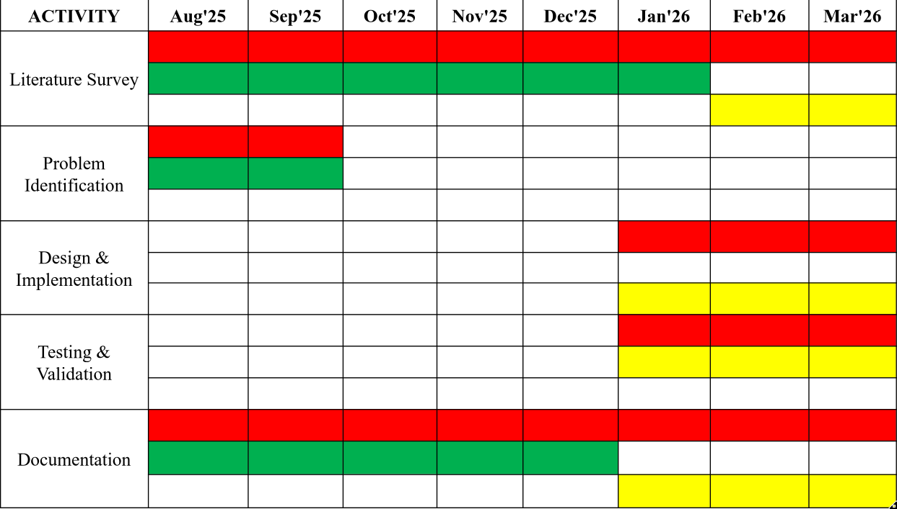

# Supply Chain Traceability Using Blockchain in the Food Industry

> By:
> Manas Prakash (202400731)
> Aayush Nandan (202400541)
> Riddhi Bhagat (202400703)
> Aryan Kumar Pitambar (202400301)
> Hardik Pratap Singh (202400745)

> Under the supervision of:
> Dr. Sandeep Gurung
> Professor

> Department of Computer Science and Engineering
> Sikkim Manipal Institute of Technology
> (A Constituent College of Sikkim Manipal University)

[[pagebreak]]

## Table of Contents

1. Introduction
2. Abstract
3. Literature Overview
4. Key Findings
5. Broad Solution and Methodology Design
6. Identify and Study Necessary Tools for Implementation
7. Online Courses
8. Gantt Chart
9. References

[[pagebreak]]

## 1. Introduction

- The modern food supply chain is highly complex, involving multiple intermediaries from production to retail, which often leads to issues of transparency, food fraud, and contamination (Aung & Chang, 2014; Galvez et al., 2018).
- Traditional traceability systems depend on centralized databases and paper-based documentation, making them vulnerable to manipulation, inefficiency, and data loss (Tian, 2017).
- Blockchain technology provides a decentralized and immutable ledger that enhances the transparency, security, and reliability of data across the food supply network (Kamble, Gunasekaran & Sharma, 2020).
- In the food sector, blockchain allows end-to-end traceability, enabling all stakeholders — farmers, processors, transporters, and consumers — to verify product origin, movement, and quality in real-time (Tian, 2017; Lin et al., 2019).
- Several initiatives such as IBM Food Trust and Walmart's Blockchain Food Safety Program demonstrate the practical potential of blockchain in reducing foodborne risks and improving recall efficiency (Kamath, 2018).
- This project explores and implements a blockchain-based traceability framework for the food industry. The concrete use case chosen is Sikkim, India's first fully organic state, where produce sold as "Sikkim organic" (cardamom, ginger, turmeric, mandarin) is frequently mislabelled. The system is realized as a working web application that records signed supply-chain events on a tamper-evident hash chain and periodically anchors a fingerprint of those events to the Ethereum blockchain.

[[pagebreak]]

## 2. Abstract

The globalization of food supply chains has increased complexity and reduced transparency, leading to frequent issues of contamination, fraud, and inefficiency. Traditional centralized traceability systems often fail to ensure real-time visibility and trust among stakeholders due to data fragmentation and limited interoperability.

This project designs and implements a blockchain-inspired traceability framework for Sikkim organic produce. Farmers register a batch and receive a QR code; handlers append cryptographically signed events (Ed25519) to a SHA-256 hash chain; consumers scan the QR code to view the verified journey and a "chain intact" or "tampered" verdict. Rather than operating a heavy consortium network, event data is stored off-chain in SQLite, and a Merkle root of recent event hashes is periodically anchored to the Ethereum blockchain through a small smart contract, providing a public, tamper-evident integrity reference. The system demonstrates end-to-end farm-to-consumer provenance, reliable tamper detection, and near-instant verification (a few milliseconds) compared with manual or paper-based recall (days), while remaining affordable and usable for small producers.

[[pagebreak]]

## 3. Literature Overview

| Author(s) | Year | Title of Paper | Inference | Research Gap | Motivation |
|---|---|---|---|---|---|
| Reshma Kamath | 2018 | Kamath, R. (2018). Food Traceability on Blockchain: Walmart's Pork and Mango Pilots with IBM. The Journal of The British Blockchain Association, Vol. 1(1), pp. 51-64. | Kamath (2018) proposes that blockchain technology can bring transparency, traceability, and accountability to food supply chains by recording every stage of a product's journey on a shared ledger. The author highlights Walmart's collaboration with IBM to track pork in China and mangoes in the US, illustrating how blockchain minimizes the time in tracing contaminated food sources from days to seconds. The paper demonstrates that decentralized data storage not only improves consumer trust but also enhances operational efficiency and regulatory compliance in global supply chains. | While Kamath effectively discusses the pilot implementation and benefits of blockchain in food traceability, the study lacks a quantitative analysis of system scalability, cost implications, and interoperability challenges with existing supply chain technologies. Moreover, the author does not deeply explore the socio-economic or infrastructural barriers that might prevent small-scale producers from adopting blockchain systems. | This paper motivates further research into creating scalable, low-cost blockchain models adaptable to different stages of agri-food supply chains. It also emphasizes the need for hybrid frameworks integrating blockchain with IoT or AI for real-time data validation, ensuring inclusivity for both large corporations and smaller producers. The study serves as a benchmark for understanding the real-world feasibility of blockchain-driven traceability systems in agriculture and food logistics. |
| Nir Kshetri | 2021 | Kshetri, N. (2021). Blockchain and sustainable supply chain management in developing countries. International Journal of Information Management, Vol. 60 (October), Article 102376. | Kshetri (2021) proposes that blockchain's inherent features such as immutability, decentralization, transparency, and smart-contract capabilities are particularly suited to addressing the sustainability challenges in supply chains of developing countries. He analyses multiple case studies of blockchain pilot projects and argues that blockchain can enhance product quality verification, environmental accounting, and social impact measurement by providing tamper-proof records and visible value-chain flows. The author shows that implementing blockchain in developing country contexts helps mitigate key issues such as opaque value delivery networks, unequal power dynamics among suppliers, and institutional weaknesses. | Although the paper provides a strong conceptual articulation and real-world case examples of blockchain in developing-country supply chains, it falls short in several ways. First, it lacks large-scale empirical validation: the case studies are limited in scope and do not quantify long-term sustainability outcomes or compare blockchain approaches with alternative technologies. Second, the cost-benefit analysis, including total cost of ownership and return on investment for blockchain solutions in low-resource environments, is not deeply explored. Third, there is insufficient coverage of the interoperability challenges with existing legacy systems, and the specific regulatory, infrastructural, and cultural barriers unique to various developing-country contexts are not fully unpacked. | This study is motivated by the fact that supply chains in developing countries often suffer more from sustainability violations such as labour exploitation, environmental non-compliance, and poor traceability than those in developed regions. Kshetri seeks to highlight how blockchain can serve as a tool to enforce sustainability standards, foster transparency and accountability, and help stakeholders meet social, economic and environmental goals. The research draws attention to the need for new frameworks that not only leverage technology but also navigate complex institutional environments, cost constraints, and power imbalances within supply chains. By developing seven propositions linking blockchain characteristics with sustainability challenges, the author aims to guide practitioners and policymakers toward creating inclusive, resilient and sustainable supply chain networks in emerging economies. |
| Vu, Nam; Ghadge, Abhijeet; Bourlakis, Michael | 2023 | Vu, N., Ghadge, A., & Bourlakis, M. (2023). Blockchain adoption in food supply chains: A review and implementation framework. Production Planning & Control, Vol. 34(6), pp. —, DOI: 10.1080/09537287.2021.1939902. | Vu et al. (2023) propose that adoption of blockchain technology in food supply chains can be significantly facilitated through a structured implementation framework that accounts for technological, organisational, and environmental dimensions. Through a systematic review of existing literature and cases, the authors identify key drivers (e.g., traceability demand, regulatory pressure, consumer trust), barriers (e.g., high cost, lack of skills, interoperability), and socio-technical factors (e.g., governance, stakeholder alignment) that influence blockchain uptake. They present a multi-stage implementation framework comprising readiness assessment, pilot execution, full-scale deployment, and continuous improvement, thereby demonstrating how firms can move from pilot experiments to scalable blockchain solutions. | Despite providing a comprehensive review and framework, the paper is limited in its empirical validation of the proposed framework in live food supply-chain environments. The study lacks detailed case studies tracking firms through the full lifecycle of blockchain adoption (from pilot to scale) and does not provide quantitative performance metrics such as cost-benefit or ROI figures across different geographies. Additionally, although it addresses environmental and regulatory factors, the interactions between blockchain adoption and supply-chain sustainability outcomes (e.g., food waste reduction, carbon footprint) are only superficially covered. Thus, future work must empirically test the framework in varied contexts and quantify the real-world benefits of blockchain integration in food supply-chains. | This study is motivated by the growing complexity and vulnerability of global food supply chains characterized by increasing consumer demand for transparency and safety, rising food-fraud risks, regulations tightening across regions, and pressure to improve sustainability and traceability. The authors aim to fill a practical gap by helping organizations transition from isolated blockchain experiments to full deployments by outlining a clear, staged framework. By collating and analyzing scattered literature, they seek to assist practitioners, supply-chain managers and policymakers to better understand the multi-dimensional challenges (technological, organizational and environmental) of blockchain adoption and provide actionable guidance on readiness, governance, stakeholder engagement, pilot strategy, and future scaling. |
| V. Pandey; M. Pant; V. Snasel | 2022 | Pandey, V.; Pant, M.; Snášel, V. (2022). Blockchain technology in food supply chains: Review and bibliometric analysis. Technology in Society, Vol. 69, Article 101954. | Pandey, Pant & Snášel (2022) propose that blockchain technology has emerged as a highly promising tool to enhance transparency, traceability, and trust in food supply chains (FSCs) by virtue of its immutable ledger, decentralised architecture, and shared visibility of value-chain events. They conduct a comprehensive review and bibliometric analysis of the literature and find that most research to date focuses on product authentication, logistics, financing, and traceability use cases in FSCs. The authors assert that blockchain is likely to become a dominant enabling technology for addressing major challenges such as food fraud, opaque supply chain flows, and stakeholder mistrust in the food sector. | While the study delivers a broad overview of blockchain's application in food supply chains and maps research trends via bibliometric techniques, it does not empirically test specific blockchain systems across diverse geographic and operational contexts. It lacks detailed quantification of performance metrics (e.g., cost savings, speed of traceability, reduction in waste) for blockchain implementations in FSCs. The work also overlooks the deeper exploration of socio-technical barriers such as small-farm adoption, infrastructure deficits, regulatory heterogeneity, and variations in digital literacy across regions. Moreover, the environmental sustainability impact of blockchain-enabled traceability (for example, how it contributes to food-waste reduction or carbon footprint) remains only tangentially addressed. | This research is motivated by the growing global pressures on food systems such as rising population, increasing demand for food safety, quality assurance, sustainability imperatives, and regulatory compliance that traditional supply-chain mechanisms struggle to meet. The authors seek to fill the gap in understanding by compiling and analyzing the expanding body of literature on blockchain in FSCs, identifying key themes, authors, journals, and geographic patterns. By performing bibliometric analysis, they aim to provide researchers and practitioners with a clear map of where research is concentrated, what areas are under-explored, and where future work should focus. The paper also intends to support industry practitioners and policymakers by highlighting the promise of blockchain for food supply-chain transformation, while drawing attention to the major obstacles that must be overcome for practical deployment such as scalability, cost, interoperability, and governance. |
| Fran Casino; Venetis Kanakaris; Thomas K. Dasaklis; Socrates Moschuris; Nikolaos P. Rachaniotis | 2019 | Casino, F., Kanakaris, V., Dasaklis, T. K., Moschuris, S., & Rachaniotis, N. P. (2019). Modeling food supply chain traceability based on blockchain technology. IFAC-PapersOnLine, Vol. 52(13), pp. 2728–2733. | Casino et al. (2019) propose a blockchain-based traceability model for food supply chains that utilizes smart contracts to automate data recording and ensure immutability of supply chain transactions. The study presents a distributed system architecture where producers, distributors, retailers, and regulatory authorities share a secure ledger to record product-related events. By eliminating centralized control, the model enhances transparency, prevents data manipulation, and improves coordination among stakeholders. The paper demonstrates how blockchain can function as a reliable technological infrastructure for strengthening food safety compliance and traceability management. | Although the study proposes a proof-of-concept blockchain model and demonstrates its conceptual feasibility, it does not provide large-scale empirical validation or real-world industrial deployment analysis. The paper lacks quantitative performance evaluation such as scalability testing, transaction throughput measurement, and cost assessment. Additionally, adoption challenges and integration complexity with existing legacy systems are not deeply examined. | Although the study proposes a proof-of-concept blockchain model and demonstrates its conceptual feasibility, it is motivated by rising food safety concerns and the weaknesses of traditional centralized traceability systems, which are prone to data tampering and inefficiencies. The authors emphasize the necessity of a decentralized and transparent system capable of ensuring trustworthy information flow across the food supply chain. The study aims to develop a structured blockchain framework that increases reliability, accountability, and regulatory compliance within agri-food networks. |
| Lorenzo Compagnucci; Dominique Lepore; Francesca Spigarelli; Emanuele Frontoni; Marco Baldi; Lorenzo Di Berardino | 2022 | Compagnucci, L., Lepore, D., Spigarelli, F., Frontoni, E., Baldi, M., & Di Berardino, L. (2022). Uncovering the potential of blockchain in the agri-food supply chain: An interdisciplinary case study. Journal of Engineering and Technology Management, Vol. 65, Article 101700. | Compagnucci et al. (2022) examine the implementation of blockchain technology in the agri-food supply chain through an interdisciplinary case study of two Italian small and medium-sized enterprises. The study demonstrates that blockchain enhances traceability, improves data transparency, and strengthens trust between firms and consumers. The findings show that blockchain adoption not only improves product information visibility but also influences organisational structures, stakeholder interactions, and value creation mechanisms within the supply chain network. | Although the study provides empirical insights through case analysis, it is limited to two firms, restricting broader generalisation. The research does not include quantitative performance evaluation such as scalability, transaction speed, cost-benefit analysis, or long-term operational impact. Additionally, large-scale adoption challenges and interoperability issues across complex supply networks are not extensively examined. | The study is motivated by increasing concerns regarding food fraud, lack of transparency, and inefficiencies in traditional centralized agri-food traceability systems. Existing systems are often fragmented, vulnerable to data manipulation, and dependent on trusted intermediaries. The authors aim to design a secure, decentralized, and scalable blockchain-based framework that enhances trust, regulatory compliance, and coordination among stakeholders in the agri-food supply chain. |
| Angelo Marchese; Orazio Tomarchio | 2022 | Marchese, A., & Tomarchio, O. (2022). A blockchain-based system for agri-food supply chain traceability management. SN Computer Science, Vol. 3(4), Article 279. | Marchese and Tomarchio (2022) propose a blockchain-based traceability management system for agri-food supply chains implemented using Hyperledger Fabric. The study presents a permissioned distributed architecture in which supply chain participants record batch-level product data onto a blockchain network to ensure transparency, immutability, and data integrity. The authors develop and demonstrate a working prototype to validate the feasibility of the proposed system, highlighting improved traceability, secure information sharing, and automated verification mechanisms across supply chain stages. | While blockchain technology has been widely discussed in supply chain management, there is a lack of practically implemented and system-oriented solutions specifically tailored for agri-food traceability using permissioned blockchain platforms. Many existing studies focus on conceptual models or theoretical discussions without presenting a concrete architecture or functional prototype. This paper addresses that gap by proposing and implementing a structured blockchain-based traceability management system using Hyperledger Fabric for agri-food supply chains. | The paper is motivated by the need to address data manipulation, lack of transparency, and inefficiencies in traditional agri-food traceability systems. The authors aim to design a scalable and enterprise-ready blockchain framework that enhances trust, compliance, and coordination among supply chain stakeholders. |
| Tian Feng (Feng Tian) | 2016 | Feng, T. (2016). An agri-food supply chain traceability system for China based on RFID & blockchain technology. 13th International Conference on Service Systems and Service Management (ICSSSM), pp. 1-6. | Tian (2016) proposes that an integrated traceability system combining RFID (Radio-Frequency Identification) with blockchain technology can provide trusted, end-to-end visibility of the agri-food supply chain in China from production through processing, warehousing, distribution, and retail. According to his study, by linking RFID data capturing environmental and lot information with a distributed ledger that records immutable transactions, the system enhances food-safety assurance, prevents tampering of traceability data, and improves consumer confidence in the supply chain. The paper demonstrates a prototype built for Chinese agri-food logistics where blockchain handles environmental monitoring data and RFID handles lot tracking, enabling a transparent and trustworthy chain of custody. | While the paper presents a promising model and a use-case simulation, it does not offer large-scale empirical validation of the system in a live commercial environment with numerous supply-chain actors. It also fails to provide detailed cost-benefit analysis, scalability metrics (such as transaction throughput or latency under high data volume), and full interoperability with legacy supply-chain systems. Additionally, while environmental data and traceability are addressed, the study does not deeply examine stakeholder incentives, regulatory compliance frameworks, or how small producers in rural China can participate in the blockchain-RFID ecosystem. | This study is driven by persistent food-safety issues in China, where repeated scandals and poor supply-chain visibility have eroded consumer trust. Tian emphasizes that traditional traceability systems relying on centralized databases are prone to tampering, data loss, and single-point failures. To address this, the research integrates RFID for real-time data capture with blockchain for decentralized, immutable record-keeping, creating a system that ensures end-to-end ("farm to fork") transparency of product provenance and environmental conditions, prevents data manipulation and fraud through tamper-resistant shared ledgers, and offers a framework to enhance trust, quality assurance, and efficiency across China's agri-food supply chain. In essence, the paper lays groundwork for future research on technical integration, stakeholder participation, and policy support for blockchain-enabled traceability systems. |

[[pagebreak]]

## 4. Key Findings

1. **Real-time Traceability** — Tracking products through the various stages of the supply chain (farmer → handler → retailer) enables quick identification of fraud, delays, or defects.

2. **Hash-Chain Integrity (instead of a Hyperledger Fabric consortium)** — Only authorized participants can append events, and each event is cryptographically linked to the previous one with SHA-256. Any alteration to a past event breaks the chain and is detected by re-verification. We chose this lighter approach over Hyperledger Fabric because it is faster, simpler to deploy, and sufficient for signed event provenance, while still providing the same tamper-evidence property.

3. **Off-Chain Storage with an On-Chain Reference (instead of IoT sensors)** — Event payloads are stored off-chain in SQLite; only a Merkle root of recent event hashes is written on-chain. This follows the "off-chain data + on-chain integrity reference" pattern and avoids expensive per-event blockchain transactions. IoT/RFID sensing was deliberately kept out of scope because signed events already capture the provenance we need.

4. **Smart Contracts** — A single Solidity smart contract (`ProvenanceAnchor.anchor(bytes32)`) commits Merkle roots to Ethereum. The contract validates that the committed root is public and immutable, although it does not automate payments or compliance.

5. **Immutability & Transparency** — Data cannot be altered once written without detection, which creates trust among all parties involved: suppliers, manufacturers, and consumers.

6. **Scalability Issues** — Blockchain still faces high transaction volume and speed constraints, which is why we anchor a single Merkle root rather than logging every event on-chain.

7. **Interoperability Issues** — Integration with existing ERPs and legacy systems remains difficult; our simple REST API and SQLite schema are designed to be easy to bridge later.

8. **Smart Contract Security Challenges** — Smart contracts are vulnerable to errors or hacking; we keep our contract minimal (a single `anchor` function) to reduce the attack surface.

9. **High Cost of Implementation** — Includes IoT devices, infrastructure, and training personnel; our design avoids hardware and uses a free testnet, keeping cost near zero for a demo.

10. **Limited Large-Scale Implementation** — The technology is still in early stages, with few scaled deployments.

11. **PKI & Key Management** — Secure management of identities is essential; poor management leads to data breaches or loss of access. Each participant holds an Ed25519 keypair, and signatures are verified before events are accepted.

12. **Off-Chain Storage Requirement** — Data cannot be stored on the blockchain; it is stored externally with the blockchain storing references (hashes).

### Scope decisions (what was cut and why)

| Cut from synopsis | Why |
|---|---|
| Hyperledger Fabric + MSP | A semester would be spent on infrastructure, not a usable demo |
| IoT / RFID sensors | Not required for provenance of signed events |
| Zero-knowledge proofs | Unnecessary for the evaluation story |
| MetaMask for consumers | Kills adoption; the consumer page is read-only and wallet-free |
| Per-event mainnet transactions | Cost and latency; we anchor Merkle roots instead |

[[pagebreak]]

## 5. Broad Solution and Methodology Design

### Goal

- Ensures end-to-end traceability from farm to consumer.
- Every transaction and movement of goods is permanently recorded.
- Eliminates dependency on a central authority, increasing trust among stakeholders.
- Helps maintain food safety, quality, and authenticity.
- Enables quick identification of issues like contamination or spoilage.
- Builds consumer confidence by providing verified product history.

### How it works

- All stakeholders (farmers, handlers, retailers, regulators) register in the network and are assigned an Ed25519 keypair.
- Each batch is assigned a unique ID and a QR code for identification.
- At every stage (harvesting, processing, packaging, transportation, retail), a stakeholder records a signed handoff event.
- Every event is cryptographically linked to the previous one with SHA-256, forming a secure hash chain.
- Data once entered cannot be altered without detection, ensuring immutability.
- All authorized parties can view real-time data, ensuring transparency.

### Result

- Faster tracking: in case of contamination, the source can be identified within milliseconds instead of days.
- Improved food safety: early detection prevents large-scale health risks.
- Prevention of data tampering: immutable records ensure data integrity.
- Reduction in counterfeit products and fake labelling.
- Enhanced transparency and trust among all stakeholders.

### System architecture

The system is a three-tier web application:

```
React (Vite) frontend   --HTTP/JSON-->   FastAPI (Python) backend   -->   SQLite
   (producer / handler /                (hash chain + Ed25519             (events,
    consumer / admin)                    signatures + Merkle root)         off-chain)
                                                       |
                                                       | publish Merkle root
                                                       v
                                        ProvenanceAnchor.sol
                                        (Ethereum Sepolia, or a local
                                         in-process tester for demos)
```

- The frontend and backend communicate only over HTTP; the frontend never holds private keys for consumers.
- Event payloads live off-chain in SQLite; the blockchain stores only a Merkle root fingerprint.

### Product registration

Each product batch is assigned a unique ID (UUID), encoded into a QR code that links to its trace record.

### Data recording process at each stage

1. The responsible participant submits new data for the product.
2. The backend builds a canonical JSON payload, signs it with the participant's Ed25519 key, and computes the event hash as SHA-256(previous hash + payload + signature).
3. The event is appended to the hash chain with a global sequence number.
4. A verifier can recompute every hash from the genesis block and detect the exact point of any tampering.

### Smart contract rules

A single Solidity contract (`ProvenanceAnchor`) exposes `anchor(bytes32 root)`, which stores a Merkle root permanently and emits an event. It is self-executing and enforces the rule that committed roots are public and immutable.

### Traceability

Each product carries a QR code that links to its blockchain-backed record. Scanning the code shows the complete, verified history of the product and a "chain intact" or "tampered" verdict, along with the latest on-chain anchor transaction.

### Measured performance

The following measurements were collected on the local FastAPI instance (anchor mode: local Ethereum tester):

| Metric | Value |
|---|---|
| Create batch | 34.25 ms |
| Event write (mean) | 38.45 ms |
| Event write (p95) | 44.83 ms |
| Verify (mean of 20) | 4.8 ms |
| Verify (p95) | 10.78 ms |
| Get batch | 1.74 ms |
| Anchor Merkle root | 108.44 ms |
| Manual / paper recall (literature) | days |
| Digital farm-to-retail verify | ~4.8 ms |

[[pagebreak]]

## 6. Identify and Study Necessary Tools for Implementation

### Web application framework

- FastAPI (Python) provides the REST API, request validation (via Pydantic), and interactive documentation.
- SQLAlchemy maps Python classes to SQLite tables; SQLite is a zero-configuration file database that keeps deployment simple for demos while remaining portable to Postgres.

### Frontend

- React with TypeScript and Vite provide the producer, handler, consumer, and admin interfaces.
- The consumer page is wallet-free and works by scanning a QR code (html5-qrcode) or pasting a batch ID.

### Public Key Infrastructure (PKI)

- PKI is responsible for managing digital identities in the network.
- Each participant holds an Ed25519 keypair; the public key identifies them and the private key signs their events.
- Signatures provide non-repudiation (a sender cannot deny a transaction) and protect against data tampering and identity spoofing.

### Cryptographic algorithms

- Hashing (SHA-256) ensures data integrity and links events into a chain.
- Digital signatures (Ed25519) verify authenticity and non-repudiation.
- Hash functions convert data into fixed-length unique values; any change to input produces a completely different hash.

### Smart contracts

- Smart contracts are self-executing programs stored on the blockchain.
- Our `ProvenanceAnchor` contract automatically enforces the rule that each committed Merkle root is permanent and public.
- Using a minimal contract reduces cost and delay, and improves efficiency, accuracy, and transparency.

### Off-chain storage & encryption

- Large or sensitive data is stored outside the blockchain (off-chain, in SQLite).
- Only a secure reference (a hash or Merkle root) is stored on-chain.
- This maintains a balance between security and efficiency.

### Blockchain anchoring (web3.py + Solidity)

- web3.py connects the backend to Ethereum.
- By default (no funded Sepolia contract configured), anchoring uses an in-process Ethereum tester, which still mines real transactions.
- With a funded wallet and a deployed contract, anchors are submitted to the Sepolia testnet and are viewable on a block explorer.

### Not used (and why)

- Hyperledger Fabric / MSP — too heavy for a semester project; the hash chain provides the same tamper-evidence.
- Zero-knowledge proof frameworks — not required for signed event provenance.
- Consumer wallets (MetaMask) — would harm adoption; consumers are read-only.

[[pagebreak]]

## 7. Online Courses

- Supply chain management in food processing industry: https://www.udemy.com/course/supply-chain-management-food-processing-industry/?couponCode=MT251110G2 [Aayush Nandan, Aryan Kumar Pitambar] (16 hrs)
- Blockchain - Complete Blockchain Course for Beginners: https://www.udemy.com/course/learn-blockchain-technology-and-cryptocurrency-for-beginners [Manas Prakash, Riddhi Bhagat] (12 hrs)
- Supply chain management: https://www.coursera.org/specializations/supply-chain-management [Hardik Pratap Singh] (64 hrs)
- Blockchain and its Applications: https://onlinecourses.nptel.ac.in/noc22_cs44/ [Manas Prakash, Aayush Nandan] (30 hrs)

[[pagebreak]]

## 8. Gantt Chart



[[pagebreak]]

## 9. References

[1] The Journal of The British Blockchain Association, vol. 1(1) — https://jbba.scholasticahq.com/article/3712-food-traceability-on-blockchain-walmart-s-pork-and-mango-pilots-with-ibm

[2] International Journal of Information Management, vol. 60 (October) — https://www.sciencedirect.com/science/article/abs/pii/S0268401221000694

[3] Production Planning & Control, vol. 34(6) — https://www.tandfonline.com/doi/full/10.1080/09537287.2021.1939902

[4] Technology in Society, vol. 69 — https://www.sciencedirect.com/science/article/abs/pii/S0160791X22000951

[5] 13th International Conference on Service Systems and Service Management (ICSSSM) — https://www.researchgate.net/publication/306063920_An_agri-food_supply_chain_traceability_system_for_China_based_on_RFID_blockchain_technology

[6] IFAC-PapersOnLine, vol. 52(13) — https://www.sciencedirect.com/science/article/pii/S2405896319316088

[7] Journal of Engineering and Technology Management, vol. 65 — https://www.sciencedirect.com/science/article/pii/S0923474822000303

[8] SN Computer Science, vol. 3(4) — https://link.springer.com/article/10.1007/s42979-022-01148-3

[9] FastAPI documentation — https://fastapi.tiangolo.com

[10] SQLAlchemy documentation — https://www.sqlalchemy.org

[11] Web3.py documentation — https://web3py.readthedocs.io

[12] Solidity documentation — https://docs.soliditylang.org

[13] Josefsson, S. & Liusvaara, I. (2017). Edwards-Curve Digital Signature Algorithm (EdDSA), RFC 8032 — https://datatracker.ietf.org/doc/html/rfc8032

[14] React (Vite) documentation — https://react.dev / https://vite.dev
